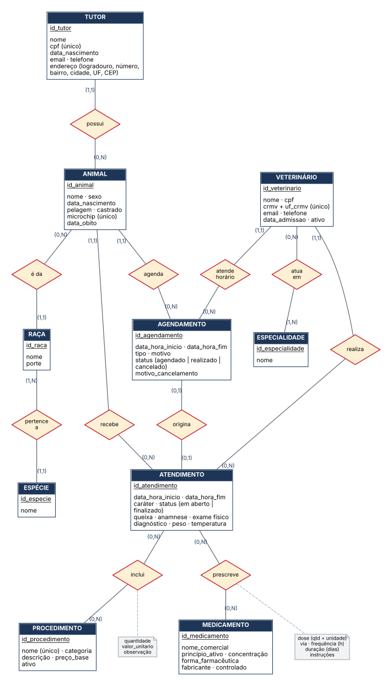
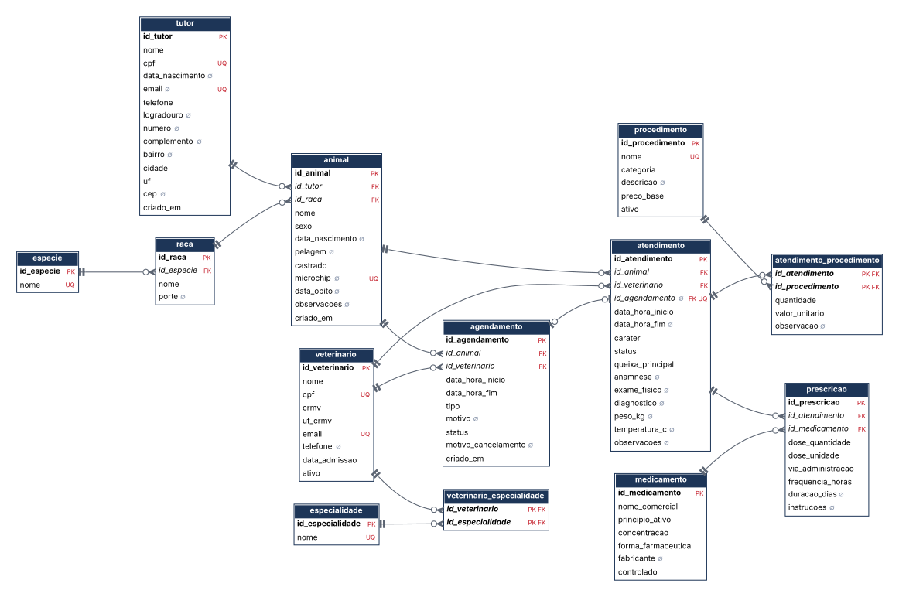
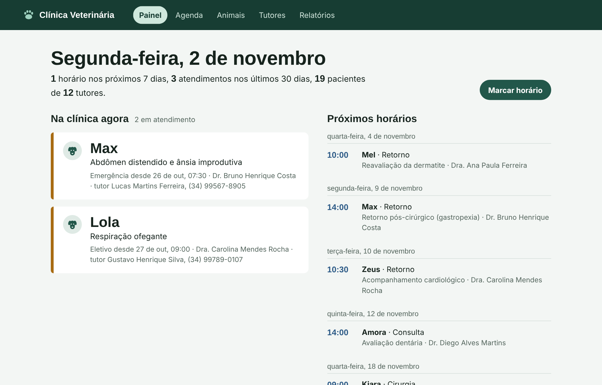

# Sistema de Gestão de Clínica Veterinária

Banco de dados relacional em **PostgreSQL** para a rotina de uma clínica veterinária: tutores, animais, veterinários, agenda, atendimentos, procedimentos, prescrições e histórico clínico.

Trabalho prático da disciplina de Banco de Dados — Engenharia de Computação, Universidade Federal de Uberlândia (UFU).

📄 **[Relatório completo (PDF)](docs/relatorio.pdf)**: modelos conceitual, lógico e físico, justificativas de normalização, tipos e índices, e a explicação de cada consulta com o resultado.

---

## Destaques

- **15 tabelas em 3FN/FNBC** com PKs, FKs, `UNIQUE`, `NOT NULL` e `CHECK` de domínio, formato e semântica.
- **CPF validado de verdade** pela função `cpf_valido()` (dígitos verificadores, módulo 11), usada no `CHECK`.
- **Regras por espécie**: vacinas, cirurgias e medicamentos restritos às espécies indicadas, garantido por gatilho.
- **Interface web** em Node.js ([`app/`](app/)) com painel, agenda, prontuário, cadastros e relatórios.
- **Regras de negócio no próprio banco**, não só na aplicação:
  - agenda sem conflito por veterinário, via gatilho que procura horários sobrepostos;
  - atendimento só pode usar um agendamento do mesmo animal e que não esteja cancelado;
  - gatilhos que marcam o agendamento como `REALIZADO`, barram atendimento de horário cancelado ou de animal com óbito e congelam o preço praticado (histórico imune a reajustes).
- **Índices justificados** nas chaves estrangeiras e nas colunas mais filtradas (compostos onde a consulta usa duas colunas).
- **Visões** `vw_animal` e `vw_historico_clinico` (prontuário consolidado).
- Scripts **idempotentes e transacionais**, com `COMMENT ON` em todos os objetos.
- Diagrama lógico **gerado a partir do catálogo** e relatório PDF **montado executando as consultas**, de modo que a documentação acompanha o código.

## Modelo

| Conceitual (Chen) | Lógico |
|---|---|
|  |  |

## Estrutura

```
.
├── sql/
│   ├── 00_criar_banco.sql      # CREATE DATABASE (rodar conectado ao banco "postgres")
│   ├── 01_ddl.sql              # esquema, tabelas, restrições, índices, gatilhos, visões
│   ├── 02_dml.sql              # carga de dados + exemplos de UPDATE/DELETE + testes de integridade
│   └── 03_consultas.sql        # 5 consultas obrigatórias + 7 complementares
├── app/                        # interface web (Node.js + Express)
├── docs/
│   ├── relatorio.pdf           # entregável
│   ├── relatorio/              # fonte do relatório (HTML + CSS)
│   └── diagramas/              # .dot (fonte), .svg e .png
├── scripts/
│   ├── gerar_diagrama_logico.py
│   ├── gerar_relatorio.py
│   └── requirements.txt
└── docker-compose.yml          # PostgreSQL 16 + pgAdmin 4 prontos
```

## Como executar

### pgAdmin 4

1. No banco `postgres`, abra a **Query Tool** e carregue `sql/00_criar_banco.sql`. Selecione só o `CREATE DATABASE` e aperte F5; depois selecione o resto e aperte F5 de novo (o pgAdmin não roda `CREATE DATABASE` junto com outros comandos).
2. Atualize a árvore, selecione `clinica_vet` e abra uma Query Tool nele.
3. Execute `01_ddl.sql`, depois `02_dml.sql`.
4. Em `03_consultas.sql`, selecione uma consulta e pressione **F5**.

Os objetos ficam em `clinica_vet → Schemas → clinica`. Para não precisar prefixar: `SET search_path TO clinica;`.

### psql

```bash
psql -U postgres -f sql/00_criar_banco.sql
psql -U postgres -d clinica_vet -f sql/01_ddl.sql
psql -U postgres -d clinica_vet -f sql/02_dml.sql
psql -U postgres -d clinica_vet -f sql/03_consultas.sql
```

### Docker

```bash
docker compose up -d
```

Sobe o PostgreSQL 16 em `localhost:5432` (usuário e senha `postgres`) já com esquema e dados, e o pgAdmin em <http://localhost:5050> (`admin@clinica.local` / `admin`). Para recomeçar do zero: `docker compose down -v`.

## Interface web



```bash
cd app
npm install
copy .env.example .env   # Linux/Mac: cp .env.example .env
# coloque a senha do PostgreSQL no .env
npm start                # http://localhost:3000
```

Detalhes em [`app/README.md`](app/README.md).

## Consultas

| # | Pergunta de negócio | Técnicas |
|---|---|---|
| Q1 | Animais com atendimento em aberto ou agendamento futuro | `IN` com subconsulta, subconsultas escalares correlacionadas, visão |
| Q2 | Ranking de veterinários por atendimentos no período | `LEFT JOIN` com filtro no `ON`, `COUNT`, `GROUP BY`, `ORDER BY` |
| Q3 | Tutores com mais de um animal + resumo de procedimentos | subconsulta com `GROUP BY` + `HAVING`, junção de 5 tabelas |
| Q4 | Medicamentos mais prescritos por espécie | junção de 6 tabelas, `COUNT`, `COUNT(DISTINCT)` |
| Q5 | Pacientes com gasto acima da média | junção de 6 tabelas, `SUM`, subconsulta com tabela derivada no `HAVING` |
| C1 | Prontuário de um animal | visão `vw_historico_clinico` |
| C2 | Receitas de um animal | junção de 4 tabelas |
| C3 | Faturamento mensal por categoria | `date_trunc`, `GROUP BY` |
| C4 | Cães e gatos sem vacina há 12 meses | `NOT IN` com subconsulta, subconsulta correlacionada |
| C5 | Agendamentos por veterinário e situação | `GROUP BY` em duas colunas |
| C6/C7 | Itens restritos por espécie | junções nas tabelas de restrição |

> Os dados vão de jan/2026 a jan/2027, com 27/10/2026 como "hoje". Q1 e C4 usam `now()`; se rodar bem depois dessa data, troque `now()` por uma data fixa.

## Regerar diagramas e relatório

Com o banco carregado:

```bash
pip install -r scripts/requirements.txt
DSN="dbname=clinica_vet user=postgres password=postgres host=localhost"

python scripts/gerar_diagrama_logico.py "$DSN" > docs/diagramas/modelo_logico.dot
for f in der_conceitual modelo_logico; do
  dot -Tsvg docs/diagramas/$f.dot -o docs/diagramas/$f.svg
  dot -Tpng -Gdpi=200 docs/diagramas/$f.dot -o docs/diagramas/$f.png
done

python scripts/gerar_relatorio.py "$DSN"    # -> docs/relatorio.pdf
```

Requer [Graphviz](https://graphviz.org/) para os diagramas.

## Autor

**Samuell** — Engenharia de Computação, UFU
